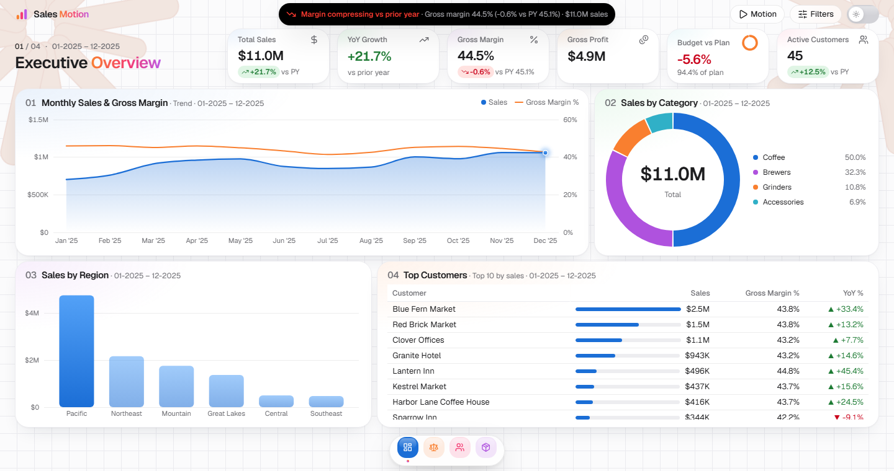
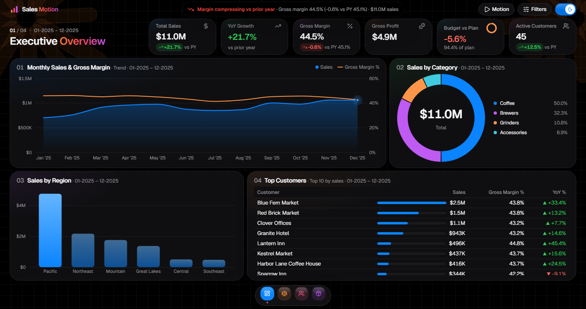
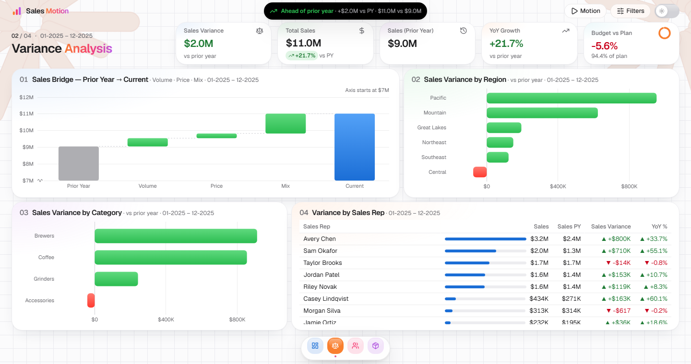
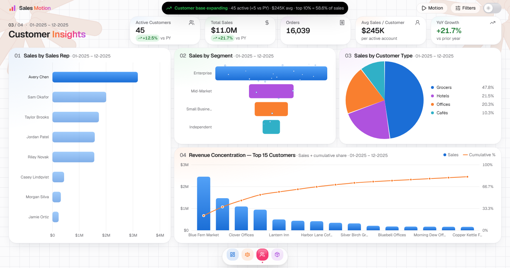
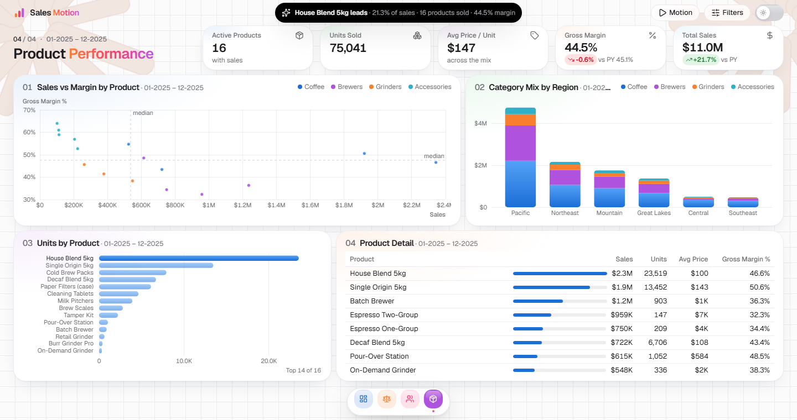

<div align="center">

# Fabric App Motion

**Motion patterns for data apps, taken from a Microsoft Fabric App I built with Claude Code.**


[](LICENSE)

[Run it on localhost](#run-it-on-localhost) · [How I built it](#how-i-built-it) · [What's inside](#whats-inside) · [How the motion works](#how-the-motion-works) · [Use your own data](#use-your-own-data) · [Screenshots](#screenshots) · [License](#license)


</div>

## What it does

- **Charts build one mark at a time.** Bars grow, lines draw, donuts sweep closed.
- **KPI numbers roll into place** like an odometer.
- **A status pill turns into a live query timer** while data loads, then shows the page's one-line insight.
- **Every card replays its build on a loop**, out of step with its neighbours, so the page keeps moving without getting busy.
- **Click a bar, slice, month or table row** and every other visual filters to it, Power BI style, then rebuilds with the same motion.

> [!NOTE]
> The original app reads live data from a Power BI semantic model. This repo runs on generated sample data instead (a made-up coffee equipment wholesaler, every name invented), so it works anywhere with no account or connection.

## Run it on localhost

> [!TIP]
> You don't need a Fabric or Power BI account. The demo creates its own sample data in the browser.

### Prerequisites

| You need | Version | Check with |
| --- | --- | --- |
| [Node.js](https://nodejs.org) (includes npm) | 20.19+, 22.13+ or 24+ (the LTS is fine) | `node --version` |
| [Git](https://git-scm.com) | any recent version, or use **Code → Download ZIP** on GitHub | `git --version` |
| A browser | current Chrome, Edge, Firefox or Safari | |

### Steps

**1. Clone the repo and go into the folder**

```bash
git clone https://github.com/nafiul-araf/fabric-app-motion.git
cd fabric-app-motion
```

**2. Install the packages** (about a minute the first time)

```bash
npm install
```

**3. Start the app**

```bash
npm run dev
```

**4. Open [http://localhost:5173](http://localhost:5173)** in your browser. The page builds itself in, then keeps moving. To stop the server, press `Ctrl + C` in the terminal.

### Other commands

| Command | What it does |
| --- | --- |
| `npm test` | Runs the unit tests for the sample-data maths |
| `npm run build` | Makes a production build in `dist/` |
| `npm run preview` | Serves that build at http://localhost:4173 |
| `npm run lint` | Checks the code with ESLint |

### Troubleshooting

| Problem | Fix |
| --- | --- |
| `npm install` fails or warns about the engine | Your Node.js is too old. Install a version from the table above and try again. |
| Port 5173 is already in use | Vite picks the next free port and prints it in the terminal, so open that address. To choose one yourself: `npm run dev -- --port 3000` |
| Windows PowerShell says `npm` "cannot be loaded because running scripts is disabled" | Run the same commands in Command Prompt, or use `npm.cmd install` and `npm.cmd run dev`. |

## How I built it

I built the app with Claude Code in two rounds: first the Fabric App itself, then the motion version this repo comes from.

> [!NOTE]
> Placeholders like `<workspace name>` replace my real workspace link and names.

### Round 1: the original Fabric App

These are **approximate**. I built the first version a few months earlier and those conversations are no longer saved, so the prompts below are reconstructed from my notes. They show what I asked for, roughly in order, not my exact words.

<details>
<summary><b>Show the 13 prompts</b></summary>

**1 · Create the app and connect the model**

> Create a Fabric App with the Rayfin dataapp template and connect it to this semantic model: `<link to the semantic model>`

**2 · Overview page**

> Build an overview page: KPI cards for total sales, gross margin and budget achievement, a sales trend against prior year, sales by category, sales by region and the top 10 customers.

**3 · Brand**

> Use the brand kit in the references folder for the colours, fonts and logo.

**4 · Layout**

> Follow the layout of the Power BI report in the references folder.

**5 · Deploy**

> Deploy the app to the `<workspace name>` workspace.

**6 · More pages**

> Add more pages: Performance, Variance, Product, Customer, Region and Budget. Each page should have its own KPI cards and slicers. Don't repeat the same cards on every page.

**7 · Filter panel**

> Move the slicers into a filter panel that opens from the right and is hidden by default. Add search inside each slicer and a reset button on each one, like Power BI.

**8 · Date range slicer**

> Replace the year dropdown with a date range slicer on the Date column, shown as mm-YYYY.

**9 · Chart choices**

> Use a donut for sales by category and product type, a pie for customer group and a funnel for segment. No data labels on the charts, axis values in millions, and green/red arrows for YoY in the tables.

**10 · Page insights**

> Add a one-line insight in the header of every page.

**11 · More analysis pages**

> Add pages for revenue quality and leakage, trends and momentum, and the product portfolio.

**12 · Fit any screen**

> Laptop screen or desktop, wherever I see the app, it should fit. No scrolling.

**13 · Rename and move**

> Rename the app to sales-analytics-app and move it to the `<folder name>` folder.

</details>

### Round 2: the motion version

These are **exact**, copied as I typed them, typos included.

<details open>
<summary><b>Show the 5 prompts</b></summary>

**1 · Convert the app**

> `<link to my app in the Fabric portal>`
>
> This my fabric app.\
> The workspace name is: `<workspace name>`\
> App Name is: sales-analytics-app (folder is `<folder name>`)
>
> This is a linkedln post for Claude Motion: https://www.linkedin.com/posts/charlie-hills_anthropic-finally-dropped-claude-motion-share-7515309471343214592--wgN/
>
> convert my sales analytics app to something similar UI in the motion linkedin post and have similar motion in the app.
>
> Save it in the same workspace and same folder. Name it to sales-app-motion

**2 · Three pages and the GIF's background**

> No need to build ten pages, for now create 3 important pages. also you have created the dark background. It should be the background same as the given likedln posts gif's background.

**3 · Move like the GIF**

> Can you make the pages as gif like movemment?

**4 · Cross-filtering**

> Suppose if I click any bar/points in a specific visual of any chart, I will filter the other as well based on this like a power bi visual does. the gif movement also be there in that situation. Is this possible? If so, do this

**5 · 50% faster**

> can you make 50% faster>

</details>

## What's inside

```text
src/
├── components/
│   ├── charts/     SVG charts, the glass tooltip and cross-filtering
│   ├── stage/      the app shell: cards, KPI strip, status pill, dock, filter sheet, replay loop
│   └── pages/      the four pages: Overview, Variance, Customers, Products
├── data/           sample data, query factories and useQuery
├── lib/            motion presets, number formatting, KPI tiles, page insights
├── global.css      colour, spacing and type tokens for light and dark
└── main.tsx        entry point
```

The demo has four pages: the three from the motion app plus a Products page, so the scatter and stacked charts appear somewhere.

**Key files**

| What | Where |
| --- | --- |
| Motion presets and the `SPEED` dial | [src/lib/motion.ts](src/lib/motion.ts) |
| Replay loop | [src/components/stage/reel.tsx](src/components/stage/reel.tsx) |
| Odometer digits | [src/components/stage/odometer.tsx](src/components/stage/odometer.tsx) |
| Status pill (query timer, then insight) | [src/components/stage/island.tsx](src/components/stage/island.tsx) |
| Card entrance and build hand-off | [src/components/stage/card.tsx](src/components/stage/card.tsx) |
| Dock navigation | [src/components/stage/dock.tsx](src/components/stage/dock.tsx) |
| Filter sheet and animated Apply button | [src/components/stage/filter-sheet.tsx](src/components/stage/filter-sheet.tsx) |
| Cross-filtering | [src/components/charts/cross-filter.tsx](src/components/charts/cross-filter.tsx) |
| Charts: bar, trend, combo, donut/pie, funnel, waterfall, scatter, stacked bar, table | [src/components/charts/](src/components/charts/) |

## How the motion works

| Idea | How it works |
| --- | --- |
| **One speed dial** | Every duration and delay goes through `fast()`, and every spring through `quick()`, which raises stiffness by SPEED² and damping by SPEED. Springs play faster but bounce exactly the same. Change `SPEED` in `motion.ts` to retime the whole app. |
| **Builds wait for their card** | A card announces the moment it has landed, and the chart inside starts building after that, so marks never grow underneath an entrance animation. |
| **Replays are remounts** | On each beat the card bumps a counter. The plot is keyed on that counter plus the result version, so the old plot blurs out and a fresh one builds from zero. New data after a filter change replays the same way. |
| **The loop knows when to stop** | Hovering a card holds it. So do the Motion pause button, an open filter sheet and an active cross-filter selection. The loop never runs for reduced-motion users or in a hidden tab. |
| **Cross-filtering** | Each query says which dimension its marks stand for. Clicking a mark stores a selection, and every other card re-queries with it while the clicked card only highlights. Ctrl/⌘/Shift-click adds members. Esc, a click on empty space or the ✕ on the chip clears it. |

## Use your own data

The charts only depend on one contract, in [src/data/types.ts](src/data/types.ts):

```ts
interface ChartQuery {
    key: string;                     // cache key: same key, same result
    columns: ColumnDef[];            // name, displayName and optional format ("$#,0", "0.0%")
    run: () => Row[];                // returns the rows
    crossFilter?: CrossFilterField;  // which dimension the marks stand for
}
```

To use real data:

1. Replace the factories in [src/data/queries.ts](src/data/queries.ts) with your own SQL, DAX or API calls.
2. Make `useQuery` in [src/data/use-query.ts](src/data/use-query.ts) await them.

The charts and the motion stay the same.

## Screenshots

<table>
  <tr>
    <td width="50%"><p align="center">Overview</p></td>
    <td width="50%"><p align="center">Overview, dark mode</p></td>
  </tr>
  <tr>
    <td><p align="center">Variance</p></td>
    <td><p align="center">Customers</p></td>
  </tr>
  <tr>
    <td colspan="2" align="center"><p align="center">Products</p></td>
  </tr>
</table>

## License

[MIT](LICENSE). You're free to use, copy, change and share this code, including in commercial work, as long as you keep the copyright and license notice.
